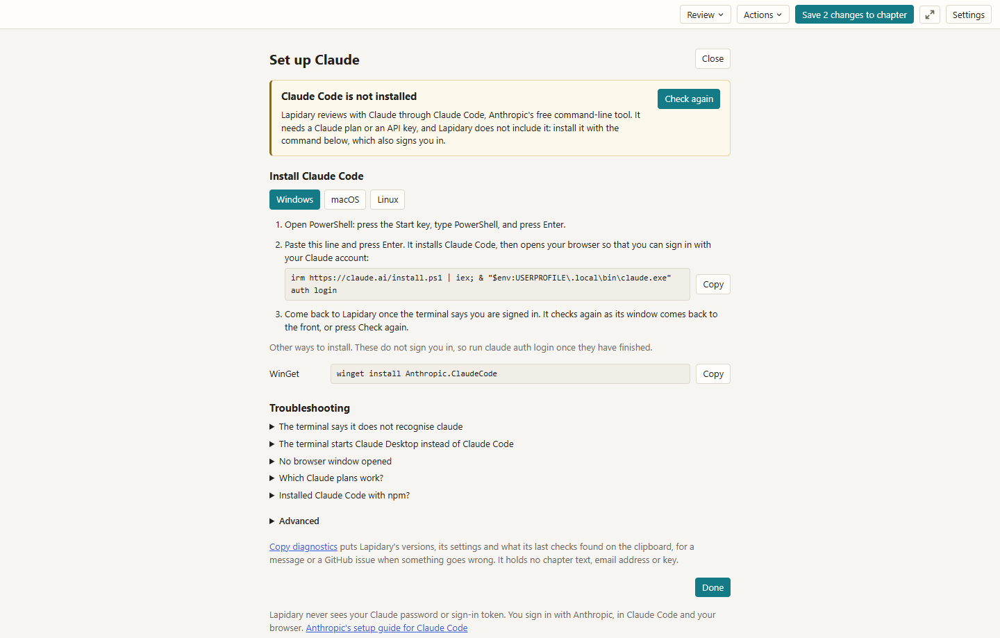
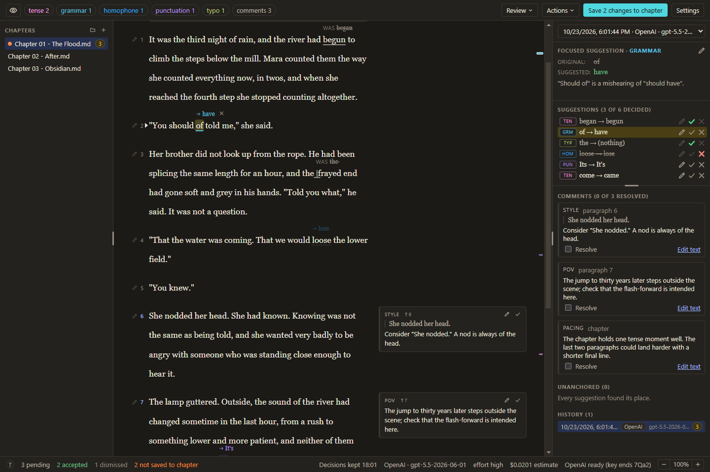

# Lapidary

[](https://github.com/MichaelBradetLegris/lapidary/actions/workflows/ci.yml)

## TLDR

- You point it at a folder of `.txt` and `.md` files, then you can write / edit / preview them.
- You can generate reviews by AI, either with Claude or ChatGPT, using your own subscription. By default, the reviews are at the proofread level (typos, spelling, tenses, etc.) If desired, you CAN edit the guidelines file (or ask an AI to edit it) so that it can perform line-level edits, although I would not recommend it.
- The AI never edits your text. You must approve every suggestion, and save to chapter when you are done.
- You can also do manual edits: paste in a manually edited chapter, and it will show you all the changes that you can manually accept.
- Has a focus mode for focused writing / editing.
- Can export HTML to convert the md into properly formatted text that you can copy paste into Royalroad directly.
- I made this for my personal use case, but if you have suggestions or features you'd like added, feel free to DM me on discord.

## Description

A Windows desktop app for reviewing AI-suggested copyedits to novel chapters kept as Markdown (`.md`) or plain text (`.txt`), for example in an Obsidian vault. Before version 1.0 it was called Stet.

You open a chapter, ask for a review, and every suggested change floats above the words it would replace. You accept or dismiss each one, in either direction, as often as you like. Larger issues (continuity, pacing, point of view) arrive as comments in the margin. Nothing is written to your chapter until you press **Save to chapter**.

![Chapter 1 of the sample manuscript after a review: suggested changes float above the words they would replace, two of them accepted and one dismissed, and comments sit in the margin. The chapter list's button, the Mode list on Main and the category chips are at the left of the toolbar, the side panel's button is at its right end, and the side panel lists the suggestions, each with its category's tag, the three decided ones in fainter words with a green tick on the two accepted and a red x on the dismissed one, and then the comments.](docs/images/review.png)

Two services can do the reviewing. You need one of them:

- **Claude**, through the Claude Code you install and sign in to yourself, on your own Claude plan or an Anthropic API key.
- **ChatGPT**, on your own ChatGPT plan, through OpenAI's Sign in with ChatGPT, with no API key.

## Requirements

- Windows 10 or 11, 64-bit (x64). No builds are made for other systems.
- About 460 MB of disk space: about 345 MB for the app and 110 MB for the copy of its installer that updates start from.
- For Claude: Claude Code 2.1.266 or newer, signed in with a Claude plan that includes Claude Code (Pro, Max, Team or Enterprise; the free plan does not), or with an Anthropic Console account or API key. Run `claude update` now and then to get the newest models.
- For ChatGPT: a ChatGPT plan that OpenAI lets you use in apps such as this one; OpenAI names Plus and Pro.

## Installing

1. Open the [latest release](https://github.com/MichaelBradetLegris/lapidary/releases/latest) and, under **Assets**, download `Lapidary-Setup-<version>.exe`, such as `Lapidary-Setup-1.0.0.exe`. It is about 110 MB. Lapidary is not code-signed, so your browser and Windows may warn you the first time.
2. Edge may say that the file isn't commonly downloaded. Point at the download, click **...** and choose **Keep**, then **Show more** and **Keep anyway**. Other browsers ask in their own words; choose to keep the file.
3. When you open it, Windows may say "Windows protected your PC". Click **More info**, then **Run anyway**.

The installer asks no questions and needs no administrator rights. It installs Lapidary for your Windows account, adds a Start menu entry and a desktop shortcut, and starts the app, which opens on its welcome guide ([First run](#first-run)). You download Lapidary only once: after that, updates arrive in the app ([Updates](#updates)).

If Windows refuses to run the installer at all, see [Troubleshooting](#troubleshooting): Smart App Control blocks apps that are not signed, and S mode runs only apps from the Microsoft Store.

**Checking the download.** Each release also holds `SHA256SUMS.txt`, with the SHA-256 checksum of the installer. To check yours, run this in PowerShell, with the installer's own name and the folder you saved it in:

```powershell
Get-FileHash "$HOME\Downloads\Lapidary-Setup-1.0.0.exe"
```

The hash it prints should match the one on the installer's line in `SHA256SUMS.txt`. PowerShell prints the letters in capitals, which makes no difference.

## Updates

Fifteen seconds after it starts, and once a day while it runs, Lapidary asks GitHub whether a newer version has been released. When there is one, a card says so, with the size of the download, and nothing is downloaded until you click **Download**. The same card then shows the download's progress and, once it is done, **Restart now**. Restart now asks about anything not saved to the chapter, as closing the window does, then closes Lapidary, runs the installer, which shows only its progress, and opens Lapidary again. Your settings, reviews, backups and open paragraph boxes stay as they were. Restart now is refused while a review is running; press it again once the review has finished.

The card gives the most the download can be: the whole installer, about 110 MB. An update can download far less, as the updater fetches only the parts of the installer that changed since the version you have: between two test builds that differed by a one-line fix, that came to 1.1 MB. An update that moves Lapidary to a newer version of Electron, the framework it runs on, changes much more of the installer. The updater compares against the copy of the installer kept in `%LOCALAPPDATA%\manuscript-review-updater`; without it, an update downloads the whole installer.

A download cut short by closing Lapidary, or finished but not yet installed, carries on at the next check without asking again. If a download or an install fails, the card says so and what to try; you can always download the newest installer from the releases page and run it over the version you have, which keeps your settings and reviews.

**About**, from the About button at the foot of Settings, shows the version you have and has **Check for updates**, with a line saying what the last check found, and **Check for updates automatically**, which turns the checks off. **What's new** opens the release page of your version, with its changes.

## Connecting Claude

The app reviews with Claude through Claude Code, Anthropic's command-line tool, and does not include it. You install Claude Code once and sign in to it yourself, with a Claude plan that includes it (Pro, Max, Team or Enterprise; the free plan does not) or with an Anthropic API key ([below](#with-an-anthropic-api-key-instead)). The app's **Setup** screen tells you what to do, one step at a time, and checks each step. If Claude Code is already installed and signed in on this computer, the app finds it and there is nothing to do.



**Opening Setup.** Setup opens by itself when you start a review with Claude while Claude Code is missing or not signed in. You can also open it from the card the app shows at start when Claude needs something (**Open Setup**), from the Claude label in the status bar, beside the zoom control, from **Settings** (**Setup** beside "Claude account"), or from the welcome guide (**Set up Claude**; see [First run](#first-run)).

**Installing and signing in.** Setup shows the steps for your system; Windows is chosen for you.

1. Open PowerShell: press the Start key, type `PowerShell`, and press Enter.
2. On Setup, click **Copy** beside the install line, paste it into PowerShell with Ctrl+V, and press Enter. The line is:

   ```powershell
   irm https://claude.ai/install.ps1 | iex; & "$env:USERPROFILE\.local\bin\claude.exe" auth login
   ```

   It installs Claude Code with Anthropic's installer, then opens your browser so that you can sign in with your Claude account. If no browser window opens, Claude Code prints a sign-in link in PowerShell: open it in your browser, and if the browser then shows a code, paste it into PowerShell.

3. Come back to the app once PowerShell says you are signed in. Setup checks again when the app's window comes back to the front, or click **Check again**. "Claude is ready", with your account and plan, means reviews can run, and the status bar at the bottom then says "Claude ready" followed by your account's email. Click **Done**, at the foot of Setup, to go back to where you came from: Review with AI when you came from its **Open Setup**, the welcome guide when you came from it, and otherwise your chapter. **Close**, at the top, and Escape do the same.

To be sure, click **Test the connection**. It sends one very small request to Claude through Claude Code, which counts against your plan like any other, and says whether Claude answered and how long it took. Nothing else on Setup sends anything to Claude: its checks only ask Claude Code for its version, its sign-in and its list of models.

Before your first review, decide whether Anthropic may train its models on your chapters: see **Model training** under [Privacy](#privacy).

**Later.** A sign-in ends from time to time. When yours does, the app says so, and Setup shows the command that signs you in again, `claude auth login`. If PowerShell says it does not recognise `claude`, use the longer form Setup shows under it, which names the program in full: Anthropic's installer puts `claude.exe` in `%USERPROFILE%\.local\bin`, a folder that may not be on your PATH. The longer form is also the way round a PowerShell where typing `claude` starts Claude Desktop instead, which an older Claude Desktop can cause. If Claude Code is too old for the app, Setup says so and shows `claude update`. A copy from Anthropic's installer keeps itself up to date.

**Other ways to install.** WinGet works too: `winget install Anthropic.ClaudeCode`, then `claude auth login` to sign in. A WinGet copy does not update itself, so run `winget upgrade Anthropic.ClaudeCode` now and then. A copy installed only with npm is not found: npm installs `claude.cmd`, a script the app cannot start, so install with the line above as well; the two can stay side by side.

### With an Anthropic API key instead

1. Create a key in the Claude Console. Reviews are then billed per token to that Console account, not to a Claude plan.
2. Add it as a Windows environment variable: open the Start menu, search for "environment variables", and choose **Edit environment variables for your account**. Under "User variables", click **New**, enter the name `ANTHROPIC_API_KEY`, paste the key as the value, and click **OK**. Then click **OK** again to close the Environment Variables window; closing it any other way loses the change.
3. Start the app, or quit it and start it again if it was running. Claude Code uses the key ahead of any sign-in, the status bar says "Claude ready (API key)", and Setup says "Claude is ready, with an API key". Delete the variable to go back to your plan.

The key must be a real environment variable, set before the app starts. Claude Code settings in `~/.claude/settings.json`, such as an `env` block or `apiKeyHelper`, are not read, because the app starts Claude Code without your settings files.

## Connecting ChatGPT

A ChatGPT plan can do the reviewing with no API key, through Sign in with ChatGPT, which OpenAI offers to open-source apps. OpenAI decides which plans it allows; it names Plus and Pro.

1. Open **Settings** and click **Setup** beside "ChatGPT account", or click **Review**, then **ChatGPT**: while you are not signed in, that opens the same view of the Setup screen. In the welcome guide, **Sign in with ChatGPT** opens it and does step 2 for you.
2. Click **Sign in with ChatGPT**. Lapidary opens OpenAI's sign-in page in your browser. Sign in there and allow Lapidary to use your ChatGPT plan; the browser then hands the sign-in back to Lapidary, and the view says "Signed in to ChatGPT", with your plan. The first time, it also says "You're using your ChatGPT plan", with **Manage usage**, which opens ChatGPT's usage settings, and **Got it**. After Got it, the view keeps "Using ChatGPT plan", with the same **Manage usage**, under "Signed in to ChatGPT".
3. Read the warning under it. On personal ChatGPT plans OpenAI may use what you send to train its models unless you turn that off: in ChatGPT, open Settings, then Data controls, and turn off Improve the model for everyone. **Open Data controls** opens that page. Lapidary cannot see the setting, so check it yourself, then tick **I have confirmed my data settings**. Your first ChatGPT review needs the box ticked, and it is kept for that ChatGPT account. You may leave training on, but turning it off is recommended.

Click **Done**, at the foot of the view, to go back to where you came from: Review with AI when you came from its **Open Setup**, the welcome guide when you came from it, and otherwise your chapter. **Close**, at the top, and Escape do the same. To review, click **Review**, then **ChatGPT**. Review with AI shows your account and the models your plan offers; unless you choose one, reviews use the first that is not a pro, codex or chat model, which the list marks "(default)". Reviews count against your plan's usage limits, and nothing is billed per token.

**Later.** Lapidary renews the sign-in by itself while you review. If OpenAI no longer accepts it, as after a month without a review or once you disconnect Lapidary in ChatGPT's settings, the review does not run: the ChatGPT view opens and says your sign-in has ended, and you sign in again. When a review reaches your plan's usage limit, or one OpenAI sets for this app, a card says so, with when the limit resets if OpenAI says and **Manage usage**, and the status bar says "ChatGPT: usage limit reached" until a review goes through. When OpenAI's answers give your plan's usage, the status bar shows it as it shows Claude's, from 80% of a limit, as in "5-hour limit 85% used, resets 15:45". **Sign out**, on the same view, asks OpenAI to end the sign-in and removes it from your computer.

## First run

The first time you start the app, a welcome guide takes the place of the main window. Only its first step is needed to start; the other three are optional. Each step says when it is done, and you can do them in any order:

1. **Connect your manuscript folder.** Click **Choose folder** and pick the folder that holds your novel's chapters: your Obsidian vault, or a folder inside it. The app lists the `.md` and `.txt` files in it and its subfolders as chapters, leaving out a few, among them the guidelines file, Excalidraw drawings and anything whose name starts with a dot, such as the `.obsidian` and `.trash` folders (the full list is under [Working in an Obsidian vault](#working-in-an-obsidian-vault)), so choose the novel's own folder rather than a vault full of other notes. It changes a chapter file only when you press **Save to chapter**, and first copies the version it replaces into the backups folder. The one file it adds of its own is `GUIDELINES.md` (step 4); the chapters you make with **New chapter**, the + beside "Chapters", go there too. Under the button, two optional rows say where your reviews and your backups are kept: in the app's data folder, unless you click **Change** beside either and choose another folder. The backups folder cannot be your manuscript folder or a folder inside it, where backups would be listed as chapters and synced; the app says so if you choose one. Settings has the same **Change** buttons, under Folders.
2. **Connect AI agents** (optional) has a part for Claude and one for ChatGPT, each saying where it stands. Either one is enough for reviews with AI, and without them you can still review a chapter by hand (**Review**, then **Manual**). **Set up Claude** opens Setup ([Connecting Claude](#connecting-claude)). **Sign in with ChatGPT** opens Setup's ChatGPT view and starts the sign-in there, in your browser ([Connecting ChatGPT](#connecting-chatgpt)); once you are signed in, the button reads **Set up ChatGPT**. **Done**, **Close** or Escape brings you back to the guide. Pressing either button while the other service is not connected makes it the one **Review with AI** starts with, and the status bar shows it; the **Review** menu offers both.
3. **Choose appearance and focus mode** (optional) has the two settings at the top of Settings. **Appearance** is Match system, Light or Dark, and the window switches as soon as you choose. **Focus mode** makes full screen hard to leave by accident: with its switch on, leaving takes holding F11 or Escape for the time you choose beside it (see **Focus mode** and **Dark mode** under [Reviewing a chapter](#reviewing-a-chapter)). Each choice is saved at once, and Settings shows it. There is nothing to finish here: the step says what is chosen, as in "Matching your system. Focus mode off.", and the line beside Start never names it.
4. **Fill in your style sheet** (optional). **Create and open** makes `GUIDELINES.md` from a template and opens it in your computer's app for `.md` files; once the file is there, the button reads **Open**. **Open folder** shows it in File Explorer instead, and also makes the file first if it is not there yet. Fill in its Style sheet section ([The guidelines file](#the-guidelines-file)), save it, and come back to the app: the step is done once the section holds something.

Then click **Start**, which works once a folder is chosen; the line beside it says which optional steps are not done yet. **Skip** closes the guide at any time. You can change the folders, the appearance and focus mode later in **Settings**, which also has **Show the welcome guide again**.

If your Claude plan is Pro, the guide sets the review model to Sonnet the first time it finds Claude ready, unless you have chosen a model already. Claude Code's Default model is Opus, which uses a Pro plan's limits fastest, and Sonnet is usually enough for copyediting. You can choose another model in **Review with AI** at any time.

## The guidelines file

`GUIDELINES.md` in your manuscript folder is sent with every review, after the app's own instructions. It is created from a template the first time you start a review or open it. **Open**, beside the file's path in Settings and in Review with AI, opens it in your computer's app for `.md` files, and **Open folder** shows it in File Explorer. To have Open use Obsidian, make Obsidian the app Windows opens `.md` files with: in File Explorer, right-click a `.md` file and choose **Open with**, then **Choose another app**, select **Obsidian** (if it is not in the list, click **Choose an app on your PC** and find `Obsidian.exe`), and click **Always**. **Just once** leaves `.md` files opening in the app they opened in before. Review with AI also says when your style sheet is still empty. Fill in your style sheet: spelling variant, Oxford comma, character names, invented words, anything the reviewer must not "fix". Both providers read the same file.

## Reviewing a chapter

1. Pick a chapter on the left. If you have hidden the chapter list, the button at the left end of the toolbar shows it again.
2. Click **Review**, then the service to review with: **Claude** or **ChatGPT**. The **Review with AI** dialog shows the chapter's size, the provider, which you can change there too, the model and effort, your guidelines file, and what happened last time. For ChatGPT it also shows your account and, before your first ChatGPT review, the warning about training with its box, and **Start review** stays disabled until you are signed in and have ticked it.
3. While it runs, a card at the bottom of the page shows progress and a **Cancel review** button. A review usually takes a minute or two. The chapter is read-only until it finishes, because the result replaces the current set of suggestions; you can open other chapters meanwhile. If the page has changes that are not saved to the chapter yet, the dialog says so, because the review reads the chapter file: **Save 3 changes, then review** writes them into the chapter and then starts, so the review sees them (if the save does not go through, nothing is sent and the dialog says why), and **Review without them** asks first, then leaves them in the old review, which you can reopen from History.
4. When it finishes, each suggestion appears in the text:
   - **Pending**: your original, underlined in the category colour, with the suggestion above it.
   - **Accepted**: the suggestion, with a plain grey underline; your original floats above it after "was".
   - **Dismissed**: your original, under a dotted grey line, with the suggestion faded above it.
5. Click a suggestion to accept or undo it. The small x beside the floating text, a right-click, or `d` dismisses. `j` and `k` move between suggestions, `a` accepts, `u` sets a suggestion back to pending, `n` jumps to the next paragraph with a comment, and Ctrl+F finds text. In the side panel's list each suggestion has a three-letter tag of its category, such as GRM for grammar, which the legend behind the status bar's **?** spells out; a suggestion still waiting has its three buttons in the colour of its words, and one you have decided has fainter words, a green tick if you accepted it or a red x if you dismissed it, and the row's other buttons faded.
6. Comments sit in the margin beside their paragraph and in the side panel. Resolving one greys it out; it does not disappear.
7. **Actions** holds **Accept all**, **Dismiss all** and **Reset**, which accept or dismiss every pending suggestion, or reset decisions, after telling you exactly how many will change. The category chips at the left of the toolbar each open a menu with a click: **Hide** or **Show** that category's suggestions, **Show only** that category, or accept or dismiss all of it. **You** is the chip of your own edits, and the **comments** chip, just before it, hides or shows the comments in the margin and the side panel. The eye before the chips shows or hides every category at once, the comments included. The **Review** and **Actions** menus open with Enter or the down arrow as well as a click; the arrow keys move through them and Escape closes them.

**Text size.** Ctrl+plus and Ctrl+minus zoom the whole window from 80% to 200%, Ctrl+0 goes back to 100%, and Ctrl+wheel works too. The same control sits at the right of the status bar. The level is remembered.

**Columns.** Drag the handle between the chapter list and the chapter, or between the chapter and the side panel, to make a column wider or narrower. The button at the left end of the toolbar hides the chapter list, and the one at its right end the side panel; the chapter takes the room, nothing stays at the window's edge, and the same button brings the column back at its last width. Its icon has that side's pane filled while the column shows. Both are kept for the next start. Dragging a handle all the way to the window's edge hides its column too: the column fades once letting go would hide it, and its button brings it back at the width it had before the drag. From the keyboard, keep pressing the arrow towards the edge past the column's narrowest.

**Full screen.** F11, or the button with two arrows at the right of the toolbar, after **Settings**, puts the window in full screen and back. Escape leaves full screen too, unless something else is open for it to close first, such as a dialog, a menu, the find bar or a suggestion's card, or you are editing a paragraph or the whole chapter. Lapidary always starts in a window.

**Focus mode.** For writing without distraction, turn on **Focus mode** in the App section of Settings, or in the welcome guide's third step, and choose how long leaving takes: 5, 10, 15, 30 or 60 seconds, 5 to start with. Going full screen then keeps Lapidary on top of every other window, and after Alt+Tab, or a click on a window on another screen, it asks Windows for the focus back; if your keys still go to the other program, click Lapidary's window. To leave full screen, or to close the window, hold F11 or Escape for the time set: the window darkens under a count of the seconds in a ring that fills as you hold, and letting go early pauses the count and leaves the message up, so the next hold carries on from where you stopped; any other key or a click goes back to your chapter and starts the count over. Focus mode cannot stop the Windows key or Ctrl+Alt+Del, and it ends by itself if Lapidary stops responding. A page, a folder or a file Lapidary opens for you, such as Show backups or the guidelines file, opens behind it, so leave focus mode to use one. A change in Settings applies the next time you go full screen.

**Dark mode.** Lapidary follows Windows' light or dark mode, and its title bar follows with it. To choose for yourself, set **Appearance**, in the App section at the top of Settings or in the welcome guide's third step, to **Light** or **Dark**; **Match system** follows Windows again. The window switches as soon as you choose.



**Models.** The review dialog lists the models the provider offers. For Claude the list comes from your installed Claude Code, so it depends on its version and your plan, and each model shows its version (such as Opus 5.5 or Sonnet 5). "Default" is whatever Claude Code currently recommends for your account. For ChatGPT the list is the one OpenAI gives your plan.

The status bar shows which provider and model answered and what it cost. Claude's figure is Claude Code's own estimate at API prices; on a Claude plan it is not what you pay. A ChatGPT review shows none, as it counts against your plan. Every review is kept in **History** in the side panel, labelled with its provider and model. The list at the top of the side panel holds the same reviews: choose one to switch to it. A chapter opens with the review you last had on screen, usually the newest; when it is an older one, a warning mark beside the list says when the newest is from.

**Review**, then **Manual**, opens **Submit manual review**, which turns a corrected copy of the chapter (pasted, or loaded from a file) into the same kind of suggestions, so you can review someone else's edits the same way. The copy is compared with the chapter file, so when the page has changes the file does not have yet, Build review asks first: save them, then build; build without them; or cancel.

## Editing in the app

You can write your own words as well as accept suggested ones:

- the faint pen beside a paragraph's number opens the whole paragraph for editing in place; several can be open at once, and **Done** (or Ctrl+Enter) applies each one;
- the pencil on any suggestion rewrites its replacement (`e` does the same for the focused one);
- **Edit text** on a comment opens its paragraph with the quoted words selected.

Each word or phrase you change becomes its own suggestion, already accepted and marked "you", and can be undone the same way. A suggestion your change runs into moves to the Unanchored list with its reasoning kept. Typing exactly what a suggestion proposed simply accepts that suggestion. Emptying the box deletes the paragraph.

What you type in a paragraph box is kept in the app's data folder within a second. If the app is closed, updated or stops while a box is open, the box comes back with your words the next time you open the chapter. If the paragraph has changed in the meantime, the box does not come back; your words are kept in a `.txt` file in the app's data folder instead, and a card's **Show the text** opens it.

Paragraphs are numbered from 1 beside the text, and the AI is shown the same numbers, so "paragraph 12" in a comment means the one labelled 12.

**Full edit and Preview.** The **Mode** list at the left of the toolbar, after the chapter list's button, switches between **Main**, the page described above, **Full edit** and **Preview**. Lapidary starts in Main, and the view you chose stays when you open another chapter or another review of it: Preview from the top of the chapter, and Full edit afresh on the chapter as it reads now, or with what you left typed there. A chapter where you left paragraphs you were editing opens in Main with them, from Preview too, and so does another review of the chapter while you have such paragraphs open. Main and Preview each keep their place in the chapter, and Full edit opens at its top. Full edit puts the whole chapter, as it reads now, on a page like Preview's that you type on, without the suggestions or comments, so you can go through it at once, with ProWritingAid for example; the frontmatter stands above the page and is left as it is, and Done and Cancel stay at the foot of the column. **Done** (or Ctrl+Enter) turns what you changed into your own edits, already accepted, as a paragraph box does, and goes back to Main; **Cancel** (or Escape) goes back without them, asking first if you typed anything. While Full edit is open the suggestions wait, and what you type is kept as a paragraph box's text is; opening another review of the chapter then asks first whether to apply what you typed in the review on screen, discard it or stay. **Preview** shows the chapter as it reads now, the way a Royal Road reader will see it, from the same HTML as **Export HTML**: the lines of a status screen close together, scene breaks, headings, quotes, lists and tables. Links in it do not open, and web images show their description instead of being loaded. The suggestion keys (`j`, `k`, `a`, `u`, `d` and `n`) work in Main only; in Preview the arrow keys scroll the page. Switching with something typed and not applied asks first what to do with it.

## Saving to the chapter

**Save to chapter** is the only thing that writes to your manuscript. It writes the text as it currently reads, with every accepted change applied, in one atomic step that keeps the file's line endings and encoding. **Copy result**, in the **Actions** menu, puts the same text on the clipboard instead. **Export HTML**, under it, puts the same text on the clipboard as HTML to paste into a Royal Road chapter: lines with no blank line between them stay close together, and Obsidian's frontmatter, comments, tags and footnote marks are left out. Selecting part of the page and copying it gives just those words, as they currently read, in plain text: none of the floating suggestions or labels come with them.

If the chapter changes on disk while it is open (for example, you edit it in Obsidian), the app notices, re-anchors the suggestions onto the new text and tells you how many it could not place. Avoid editing the same chapter in Obsidian while you are accepting changes here ([Working in an Obsidian vault](#working-in-an-obsidian-vault) says why).

Your decisions are kept in the review automatically as you go; there is nothing to save there, and the status bar says when they were last kept ("Decisions kept 14:02"). Until you press **Save to chapter**, the button counts the changes the chapter file does not have yet ("Save 3 changes to chapter"), the window's title starts with a dot before the chapter's name, and the status bar says "3 not saved to chapter". An orange dot marks the chapter in the list on the left too, and stays there when you open another chapter or restart the app, so you can see which chapters still have changes to save. The dot, the button and the status bar go by the review on screen, which is the one the chapter opens with: if you switch to another review of the chapter, changes you left unsaved in the first stay in it, and the list at the top of the side panel counts them on its line ("2 not saved to chapter"). The first time a change is waiting, a note under the toolbar points at the button and names the file it writes; **Got it**, or your first Save to chapter, puts it away for good. Ctrl+S saves too. Opening another chapter while changes are not saved asks first: save them, keep them for later, or stay. Keep for later keeps your decisions in the review and any paragraph you are editing, which opens again when you come back to the chapter. Closing the window asks the same: save and close, close and keep them for later, or cancel.

**Backups.** Before Save to chapter replaces a chapter file, it copies the version it replaces into the backups folder, where each chapter has a folder of its own and each copy is named by the time of the save and the chapter's file name. The backups folder is in the app's data folder unless you choose another, with **Change** beside **Backups** in Settings or in the welcome guide; it cannot be your manuscript folder or a folder inside it. Choosing another leaves the backups made so far where they were. If the copy cannot be made, as when the backups folder is on a drive that is not connected, nothing is written and a card says why. For each chapter the copies from the last 20 saves are kept, plus the first of each day for 30 days. **Show backups**, in the **Actions** menu, opens the open chapter's backup folder in File Explorer with the newest backup selected, and Settings has a **Backups** row that shows where they all are, with **Change** and **Show in folder**. A chapter you rename or move gets a new backup folder; the old one keeps its name.

There is no restore button. A backup is the chapter file as it was, byte for byte, so it opens in Notepad or any text editor. To take back a passage, open the backup and copy the words into the chapter in Obsidian. To take back the whole chapter, first copy the chapter as it is now to a folder outside your vault, then paste the backup's whole text over the chapter's in Obsidian. Keep backups out of your vault: a copy there is listed as a chapter, and your sync tool syncs it.

## Working in an Obsidian vault

Lapidary reads and writes your chapter files where they are. Obsidian does not need to be open, and nothing needs installing in it.

**Which files are chapters.** Every `.md` and `.txt` file in the manuscript folder and its subfolders. Lapidary leaves out files and folders whose names start with a dot, such as `.obsidian` and `.trash`; folders named `node_modules`, `out` or `dist`; your reviews folder, if you chose one inside the manuscript folder; the guidelines file (`GUIDELINES.md`, or the one you chose in Settings); drawings of the Excalidraw plugin (files whose names end `.excalidraw.md`); and links to files or folders kept somewhere else (symbolic links and junctions), so keep the chapters themselves in the folder. Images, PDFs, canvases and other attachments are never listed or touched. A review covers a whole file, so keep one chapter to a file: from 12,000 words the review dialog notes that a chapter is long, and from 40,000 it warns that the model may run out of room before it has written every suggestion.

**What you see.** The chapter exactly as you typed it, as plain text. Links, callouts, comments, `*emphasis*` and headings keep their characters, and nothing is rendered or styled. The frontmatter, the properties block between `---` lines at the top of a note, is shown as a grey box above the first paragraph. It is never sent to the reviewer, gets no suggestions and cannot be edited here, and Save writes it back as it was.

**What the reviewer is told.** Lapidary tells the reviewer to leave internal links and embeds, tags, block IDs, footnote and callout markers, `%%` and HTML comments, code, maths, web addresses and HTML exactly as written, and that it may still correct the words a reader sees: the alias in `[[Page|alias]]`, the text of a link, a footnote's words, and a callout's title and text. Words in angle brackets that are not HTML, such as `<Where are you?>`, count as prose. A paragraph that holds nothing but `%%` or HTML comments, code or `$$` maths is not sent at all: the reviewer sees only its number. A comment in a paragraph that also holds prose is sent with the prose.

**Suggestions that would change syntax are kept out.** Lapidary does not put a suggestion in the text if it would still change Obsidian syntax, for example the page name inside `[[...]]`, a tag or a comment; if it would add or remove one of `[ ] % $ ^ # < > | ~`, a backtick or a line break, or change the words on both sides of one; or if it would join or split paragraphs. So a suggestion that turns "teh | cat" into "the | cats" is kept out, and so is one that joins two lines of verse inside a paragraph. It is listed under **Unanchored** in the side panel, with the reviewer's reason and a note such as "Kept out of the text: it would change Obsidian syntax (an internal link). Make this change in Obsidian or with the paragraph pen if you want it." So links, embeds and tags keep working whatever you accept. A suggestion that starts exactly where the one before it ends is kept out too, since the two together could change syntax that neither changes alone. Not protected:

- emphasis and highlight markers (`*`, `_`, `==`), which a suggestion may add or take away; you see it in the text before you accept it;
- what you change yourself, with the paragraph pen or the suggestion editor, and the suggestions **Submit manual review** makes from a corrected copy: they go in as written;
- Dataview fields and Templater commands, which get no special handling: check any suggestion inside one before you accept it.

**Files Lapidary will not open.** It reads files saved as UTF-8, which is what Obsidian writes, up to 4 MiB. A file in another encoding, such as UTF-16 or Windows-1252, is not opened: the message says what the file most likely is and how to save it again as UTF-8 in Notepad. A UTF-8 file with a few damaged characters is not opened either, and needs different care: the message gives the line of the first one; retype them in Obsidian and save there, and do not re-save the file in Notepad, which would garble every accented letter in it. A file that is not text at all is not opened, and the message offers no fix. In every case the file is left as it was. Split a file larger than 4 MiB into chapters.

**What Save keeps, and what it does not.** Save to chapter changes only the words your decisions and edits change. Every other character stays as it was, the frontmatter included, and so do the file's line endings, its byte order mark if it has one, and its final line break; a file that mixes Windows and Unix line endings is written with Windows ones throughout. Before it replaces the file, Save copies the version it replaces into a backup in the app's data folder, never into your vault. It then writes the new text to a temporary file beside the chapter, whose name starts with a dot, and puts that file in the chapter's place in one step, so a crash cannot leave half a chapter. Because of that, **Save resets the file's creation date**: after a save that changes the file, File Explorer's "Date created" is the time of the save. Keep that in mind if you sort or find notes by the date they were created. When the file already reads like the page, Save writes nothing and the file keeps both its dates.

**Editing in Obsidian at the same time.** Lapidary watches the manuscript folder. When a chapter you have open changes on disk, because you typed in it in Obsidian or a sync tool brought a new version, Lapidary reloads it, moves the suggestions onto the new text and says how many it could not place. Save reads the file again just before it writes; if the file has changed, nothing is written: Lapidary reloads it, says what moved and tries once more. Still, do not type in a chapter in Obsidian while you are saving it here. Lapidary cannot stop another program from writing the file a moment after its check, and it sees such a write only afterwards, when it reloads the chapter. Finish in one app, then switch.

If another program holds the manuscript folder when Lapidary starts, the chapter list says "Lapidary is not watching the manuscript folder, so changes made outside Lapidary will not show until Try again succeeds." Click **Try again** once that program has let go.

**Renaming and moving chapters.** If you rename, move or delete the chapter that is open, Lapidary says so; open it again from the list. Its reviews come with it, and a card says where they were, if its text has not changed since Lapidary last read or saved it (chapters under 500 characters excepted), or, when you move the whole vault, if the chapter keeps its file name and the name of its folder. A chapter you rename or move and also edit before you open it in Lapidary again starts with no review; its earlier reviews stay in the reviews folder under the old name. Its backups stay in a folder named after the old file name.

**Sync tools and git.** Lapidary works with any sync tool and with git. When Obsidian Sync, Dropbox or Syncthing keeps two versions of a chapter, the copy is listed with a "conflict copy" badge under its name; point at the badge to see which chapter it copies. Lapidary never hides, moves or deletes either version: compare them in Obsidian and keep the words you want. A chapter with merge markers, lines that start with `<<<<<<<` or `>>>>>>>` where git or a sync tool found two versions that disagreed, opens with a warning: remove the markers in Obsidian, keeping the words you want, before you review or save it. If a pull or a sync brings markers just as you save, nothing is written and the markers are shown on the page. When a sync tool, antivirus or Obsidian holds the file for a moment, Save tries again for about a second and a half before it says what Windows refused.

**What Lapidary adds to your vault.** `GUIDELINES.md` (or the guidelines file you chose in Settings), the chapters you make with **New chapter**, your reviews if you chose a reviews folder inside the vault, and, for the moment a save takes, its temporary file beside the chapter. Backups, drafts, settings and logs stay in the app's data folder.

## When something goes wrong

Most problems come with a card that says what happened and what to try. For anything else:

- **Copy diagnostics**, near the foot of the Setup screen, and in About, puts on the clipboard what someone helping you needs to know: the versions of Lapidary, Electron, the OpenAI library and your Claude Code; your review and display settings; what the last checks of Claude and ChatGPT found; the paths of your manuscript folder, the reviews folder, the guidelines file and the app's data folder, with your user folder written as `~`; how many chapters the manuscript folder holds, and whether it is in an Obsidian vault, in git or in a cloud folder such as OneDrive; and the log's recent warnings, each as what failed and its error code. On the Setup screen a Diagnostics window opens with it and shows exactly what was copied; About shows the same text. It holds no chapter text, chapter names, email address or key, and runs no check of its own, so it costs nothing.
- **The log**, `main.log` in the `logs` folder of the app's data folder, records what happened: start and quit, what each check of Claude or ChatGPT found, each review and save as sizes, counts and times, requests that failed, and problems the app worked around. **Open log folder** in About shows it. It never holds chapter text, guidelines, prompts, replies, keys or email addresses, and your user folder appears in it as `~`.
- When something fails that Lapidary did not expect, a card says so, with **Show diagnostics**. If the window cannot be drawn, a page takes its place that first writes your decisions and open paragraph boxes, then offers **Reload window**; they are there when you open the chapter again. If the window's process stops, a box offers **Reload window** or **Quit**.

To report a problem, open an issue on [GitHub](https://github.com/MichaelBradetLegris/lapidary/issues) and paste what Copy diagnostics copied. Issues are public: read the text first, and leave out chapter text, keys, email addresses, your Windows user name and any folder name you would rather not show. Security problems go privately, as [SECURITY.md](SECURITY.md) says.

## Troubleshooting

**"Windows protected your PC"** when you open the installer: this is SmartScreen, which warns about programs it has not seen often. Click **More info**, then **Run anyway**. Lapidary is not code-signed, so it may warn again about each new installer you download yourself.

**Smart App Control blocked Lapidary.** On a Windows 11 PC where Smart App Control is on, an app that is not signed, and that Microsoft's service does not already know, is blocked outright, with no **Run anyway**. Lapidary is not signed. Windows Security shows whether Smart App Control is on, under **App & browser control**. There is no way past it from Lapidary's side: open an issue if it blocks you, as a signed build is planned only if someone needs one.

**Windows in S mode** runs only apps from the Microsoft Store, so the installer does not run. Leaving S mode is free but cannot be undone; Microsoft's support pages explain it.

**A PC with an ARM processor**, such as a Snapdragon laptop. Lapidary is built for x64 only. Windows 11 on ARM runs x64 apps through its own emulation, though Lapidary has not been tried there; Windows 10 on ARM cannot run them.

**Claude: not signed in, or the sign-in has ended.** Setup says so and shows `claude auth login`, with a longer form for a PowerShell that does not find `claude` ([Connecting Claude](#connecting-claude)). Nothing in Lapidary is lost when a sign-in ends.

**Claude: signed in, but Lapidary still says not signed in.** Click **Check again**. Lapidary starts Claude Code without your Claude Code settings files, so a sign-in kept there, such as an `apiKeyHelper` or an `env` block in `~/.claude/settings.json`, does not reach it. Sign in with `claude auth login`, or set `ANTHROPIC_API_KEY` as a Windows environment variable ([With an Anthropic API key instead](#with-an-anthropic-api-key-instead)).

**Claude: a usage limit.** From 80% of one of your plan's limits, the status bar says how much is used and when it resets. When a review stops at a limit, its message says what to do: wait until the limit resets, and use Sonnet or Haiku afterwards, which use your limits more slowly than Opus models (Default included); or, when the limit is a weekly one for one model, choose another model under **Model** in Review with AI and go on.

**A chapter will not open**, with a message that it is saved as UTF-16, in an older encoding or with damaged characters, or that it is not text: see **Files Lapidary will not open** under [Working in an Obsidian vault](#working-in-an-obsidian-vault).

**Save to chapter keeps failing** with a message that Windows refused the write. Another program, such as a sync tool or a virus scanner, may be holding the file: Save waits about a second and a half for it, and you can save again once it has let go. If it keeps happening, Windows Security's Controlled folder access may be blocking Lapidary: allow it under Windows Security > Virus & threat protection > Ransomware protection > Allow an app through Controlled folder access. Nothing is written to the chapter while a save is refused.

**Lapidary could not read its settings.** When it says another program may have `settings.json` open, such as a backup or sync tool, a virus scanner or an editor, close that program and click **Try again**. When it says `settings.json` is damaged, mend the file, or move it out of its folder to start afresh, then click **Try again**. Until the file can be read, Lapidary changes nothing in it, so your settings are kept.

**Check for updates says GitHub could not be reached.** Check the internet connection and click **Check for updates** in About again.

## Privacy

**The app itself** has no analytics and no crash reporting. Links you click open in your web browser.

**Update checks.** Each check asks github.com for the list of Lapidary's releases and the newest release's details, and a download fetches its installer from GitHub. A check sends nothing about your chapters and no id of your copy of Lapidary. **Check for updates automatically**, in About, turns the checks off.

**What a review sends, and when.** Only when you start a review in the Review with AI dialog (**Start review**, or, when the page has changes not saved to the chapter, **Save 3 changes, then review** once the save has gone through, or **Review without them** once you have answered its question) does the app send the provider you chose:

- the app's own review instructions;
- your guidelines file;
- the chapter's text as saved on disk, without its frontmatter, as numbered paragraphs, a paragraph that holds nothing but comments, code or maths sent as its number alone;
- the chapter's file name, without its folder or extension.

It does not send the folder's path, other chapters, earlier reviews, your decisions or your settings. For ChatGPT, the app also asks OpenAI for the models your plan offers when the review dialog shows ChatGPT, and renews your sign-in with OpenAI when it is about to run out; neither sends chapter text.

**Claude Code at launch.** Each time the app starts, whichever provider you use, it runs your Claude Code to check its version and sign-in and to get its list of models. This launch check sends no model request, so it uses none of your plan's usage, and neither does Check again. **Test the connection**, on the Setup screen, sends one very small request, and only when you click it. Claude Code itself may contact Anthropic whenever it runs, as it does in a terminal.

**Claude Code's own data collection.** Claude Code reports usage metrics, which Anthropic says never include your prompts, code or file paths, and, for Pro and Max sign-ins, error reports. That is Claude Code's doing, not the app's. To turn them off, add these Windows environment variables, the same way as `ANTHROPIC_API_KEY` above, and then start the app:

- `DISABLE_TELEMETRY` with the value `1`;
- `DISABLE_ERROR_REPORTING` with the value `1`.

They apply to Claude Code everywhere, not only in this app. Setting them in `~/.claude/settings.json` has no effect here, because the app starts Claude Code without your settings files. `CLAUDE_CODE_DISABLE_NONESSENTIAL_TRAFFIC` turns off both and more, but it also stops Claude Code updating itself.

**Model training.** On a Pro or Max plan, Anthropic trains its models on your Claude Code sessions, these reviews included, when the model-improvement setting in your Claude account is on. Check it at [claude.ai/settings/data-privacy-controls](https://claude.ai/settings/data-privacy-controls). Anthropic keeps the data for 5 years with the setting on, and for 30 days with it off. Team, Enterprise and API accounts are not used for training unless the organisation chooses to share its data.

**No transcripts.** The app runs Claude Code with `--no-session-persistence`, so Claude Code saves no transcript of a review on your computer.

**ChatGPT.** Requests are sent with `store: false`, so OpenAI does not keep the response for later retrieval. On a personal ChatGPT plan OpenAI may train on what you send unless you turn that off under Data controls in ChatGPT's settings ([Connecting ChatGPT](#connecting-chatgpt)).

**Credentials.**

- **Claude**: the app never reads, stores, displays or proxies your Claude credentials. You sign in through Anthropic's own flow in Claude Code. An `ANTHROPIC_API_KEY` or other Claude Code sign-in variable in your environment reaches Claude Code unread and unchanged, because Claude Code inherits the app's environment.
- **ChatGPT**: your ChatGPT sign-in is the one credential the app stores. **Sign in with ChatGPT**, on the Setup screen's ChatGPT view (**Settings**, **ChatGPT account**, **Setup**), opens OpenAI's own sign-in page in your browser. You sign in there, so the app never sees your ChatGPT password; once you allow the app, your browser hands the sign-in back to it on your own computer. The app keeps the sign-in's tokens encrypted with Windows' data protection for your login (Electron `safeStorage`), in `secrets.json` in the app's data folder, never in `settings.json`. Only the app's background process decrypts them, at the moment of a request; they are never shown and never sent to the app's window, which learns only whether you are signed in and your plan. If Windows cannot encrypt, the app keeps no sign-in. Beside the tokens, unencrypted, it keeps your plan, whether you ticked the data settings box, an id for your ChatGPT account, the id OpenAI issued the app for that account and an id the app made for this computer. **Sign out** asks OpenAI to end the sign-in, then removes it. The same view warns that on personal ChatGPT plans OpenAI may use what you send to train its models unless you turn that off under **Data controls** in ChatGPT's settings, which the app cannot check; **Open Data controls** opens that page, and the box **I have confirmed my data settings** is kept for each ChatGPT account.

## Where the app keeps its data

**The app's data folder** is `%APPDATA%\ai-grammar-checker`; its name dates from before the app was renamed. **Open data folder** in About opens it. It holds:

- `settings.json`: your settings. If it was ever damaged (not valid JSON), Lapidary kept a copy named `settings.json.corrupt-<time>` beside it and started again from its default settings. While the app cannot read it, because another program holds it open, or because it is damaged and cannot be copied aside, the app says so with Try again and changes nothing in it.
- `secrets.json`: the ChatGPT sign-in's tokens, encrypted, and beside them, unencrypted, the sign-in's plan, its data settings box and its ids. It exists only once you have signed in with ChatGPT. If it was ever damaged, Lapidary kept a copy named `secrets.json.corrupt-<time>` beside it before writing a new one. While another program holds it open, the app changes nothing in it and says so.
- `reviews\`: your reviews, unless you chose another reviews folder in Settings. Each review holds the full text of its chapter.
- `backups\`: the versions of your chapters that Save to chapter replaced, a folder for each chapter, with a `chapter.json` naming the chapter file, unless you chose another backups folder in Settings or the welcome guide.
- `drafts\`: what you have typed in open paragraph boxes and in Full edit, and in `drafts\set-aside\` the text of boxes that could not be put back.
- `logs\main.log`, and `main.1.log` once it fills: the log ([When something goes wrong](#when-something-goes-wrong)).
- `.updaterId`, once Lapidary has checked for updates: a random id the update library keeps. Lapidary never sends it.
- Folders that Electron keeps for itself, such as caches.

**The app** is installed in `%LOCALAPPDATA%\Programs\manuscript-review`, and **the copy of its installer** that updates start from is in `%LOCALAPPDATA%\manuscript-review-updater`.

Your chapters change only when you click **Save to chapter**. Besides them, the app adds to your manuscript folder only `GUIDELINES.md`, once and never overwritten, the chapters you make with **New chapter** and, if you chose a reviews folder inside it, your reviews. Claude Code keeps its own sign-in and settings; the app holds none of them.

## Uninstalling

In Windows 11, open **Settings > Apps > Installed apps**, click **...** beside Lapidary and choose **Uninstall**; in Windows 10, **Settings > Apps > Apps & features**, then Lapidary and **Uninstall**. This removes the app, its shortcuts and its entry in the list. It leaves your manuscript folder alone, and it also leaves the app's data folder and the copy of the installer, so a later install finds your settings and reviews again.

To remove those too, delete the two folders once Lapidary is uninstalled: press Windows+R, type `%APPDATA%`, press Enter and delete the `ai-grammar-checker` folder; then do the same with `%LOCALAPPDATA%` and the `manuscript-review-updater` folder. Deleting the data folder deletes your ChatGPT sign-in (sign out first for OpenAI to end it too) and, unless you chose other folders for them, your backups and your reviews. Claude Code is a separate program; it stays installed, and Anthropic's documentation says how to remove it.

## Building from source

Most people should use the installer from [Installing](#installing). To build it yourself you need Node.js 24, or 26 and later, or 22.18 and later on the 22 line; versions 23 and 25 do not work.

1. Install [Node.js](https://nodejs.org/), the version the site marks LTS. Its installer offers optional tools for native modules; you do not need them.
2. Get the source code: on the repository's GitHub page click **Code**, then **Download ZIP**, and unzip it. If you use Git, clone the repository instead.
3. Open the unzipped folder that holds `package.json`; it may sit inside a folder of the same name. Right-click an empty space in it and choose **Open in Terminal**. On Windows 10, hold Shift while you right-click and choose **Open PowerShell window here**.
4. Type these two commands, pressing Enter after each:

   ```powershell
   npm.cmd ci
   npm.cmd run package
   ```

   Type `npm.cmd`, not `npm`: Windows blocks PowerShell scripts by default, and plain `npm` would start one. The commands need an internet connection and take a few minutes. npm prints several warnings about deprecated packages and install scripts; these are expected. The build worked if no line starts with `npm error`.

5. Open the `dist` folder inside it and double-click `Lapidary-Setup-<version>.exe`. It installs the app as the released installer does. These builds are not code-signed either, so if Windows says it protected your PC, click **More info**, then **Run anyway**.

A copy you build this way checks the published releases for updates, as a downloaded one does. To install a newer build of your own, run the installer it makes. [CONTRIBUTING.md](CONTRIBUTING.md) has the rest of the commands.

## Contributing and security

[CONTRIBUTING.md](CONTRIBUTING.md) covers building, testing and the rules for changes. To report a security problem, see [SECURITY.md](SECURITY.md). The design log is [PLAN.md](PLAN.md), and the rules for coding agents are in [CLAUDE.md](CLAUDE.md).

## Licence and disclaimer

MIT licence; see [LICENSE](LICENSE). The installed app's `resources` folder holds `LICENSE.txt` and `THIRD_PARTY_NOTICES.txt`, the licences of the software it includes, which About's **Licences and notices** opens.

Lapidary is an independent open-source project. It runs Claude Code, made by Anthropic, which each user installs and signs in to themselves. It can also review with ChatGPT, on each user's own ChatGPT plan, through OpenAI's Sign in with ChatGPT. Lapidary is not made, endorsed or sponsored by Anthropic or OpenAI, and it includes no Anthropic software.

Nor is it made, endorsed or sponsored by the makers of Obsidian. It works on the Markdown files a vault holds and needs nothing installed in Obsidian.

Suggestions and comments come from an AI model and can be wrong or misleading. Check each one, and verify any factual claim, before you accept it.
